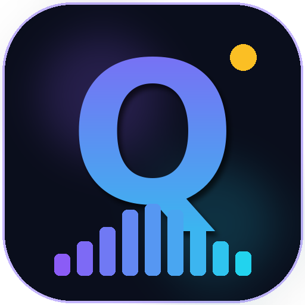

# qwen3-tts_studio 🇺🇸 — sleek dark UI for premade American voices in high quality



A beautiful dark-modern web studio built around the official **`qwen-tts`** package
(Qwen3-TTS by Alibaba Qwen Team, Apache-2.0). Defaults to the **high-quality
1.7B CustomVoice** model with the two premade **American voices front and center**:
**Aiden** ☀️ (sunny American male) and **Ryan** ⚡ (dynamic rhythmic male) — plus all 7 other premium timbres.

  

## Features

| Tab | What it exposes |
|---|---|
| 🎙️ **Studio** | Voice dropdown (American group first), 11 languages (Auto + 10), model switch **1.7B High-Quality ⭐ / 0.6B Fast**, style/emotion **instruct** + 20 preset chips (1.7B-only), advanced sampling (temperature, top-p/k, max tokens, seed), ⚡ **Stream mode** (sentence parts, first audio fast, real progress, stitched WAV), sample texts, `Ctrl+Enter` |
| ✨ **Voice Design** | 1.7B-VoiceDesign: free-form voice description → brand-new timbre, 8 inspiration presets |
| 🧬 **Voice Clone** | Base 0.6B/1.7B: reference upload **or mic recording**, transcript + `x_vector_only_mode` toggle |
| ✍️ **Script** | Free local-LLM script writer (Ollama, unfiltered; default writer **Dark Idol**) + optional cloud backends (**Groq**, **Gemini**, **Grok/xAI**, **Claude/Anthropic**), 12 scenario types incl. **Dialogue**, one-click **Write & Speak** pipeline, **Send to Studio / Send to Duet / Write & Perform duet** |
| 👥 **Duet** | Two-speaker dialogue: `A:`/`B:` lines performed by two voices, per-line playback, stitched file |
| 🔊 **Now Playing** | Live FFT waveform visualizer, download WAV (24 kHz), replay |
| 📚 **Library** | Auto-saved history with play / download / delete + tick-to-**stitch** selected files |

Plus: live job status bar (real phases + self-calibrating %), ⏹ Cancel with memory unload, ⏻ Restart / ⏻ Exit server controls, hover-`?` explanations on all ~35 controls, persistent `errors.log` with viewer endpoint.

Backend: `FastAPI` (`server.py`) — lazy model loading, single-worker job queue, REST API, static hosting. CPU `bfloat16` (auto) / GPU `bfloat16` + CUDA.

## Requirements

| | |
|---|---|
| OS / Python | Linux/WSL + Python 3.12 (`python3 -m venv .venv`) |
| RAM | 8 GB for 1.7B (weights ~3.5 GB resident); script writer parks TTS to fit |
| GPU | Optional — auto-detected, strongly recommended for interactive speed |
| Optional | [Ollama](https://ollama.ai) for the free local Script writer; free-tier cloud keys for the cloud writers (**Groq**, **Gemini**, **Grok/xAI**, **Claude**). **Ollama is optional, not required** — TTS, cloning, design, and cloud writers all work without it; the Script tab says so inline when it's down |

## Quick start

```bash
python3 -m venv .venv && source .venv/bin/activate
pip install -r requirements.txt
pip install torch torchaudio --index-url https://download.pytorch.org/whl/cpu  # CPU machines
./start.sh
# → open http://localhost:8000
```

GPU machine? Just `pip install -r requirements.txt` (gets CUDA torch) — the server auto-uses it.

Windows 11: double-click the **qwen3-tts Studio** desktop icon (see `assets/windows/`) — it boots Ollama + backend and opens Edge. The ⏻ Exit button in the header stops everything again.

## Pre-download weights (recommended)

First synthesis auto-downloads from Hugging Face (~2–4 GB for 1.7B). To pre-warm:

```bash
source .venv/bin/activate
python download_model.py            # default: 1.7B CustomVoice (HQ) + tokenizer
python download_model.py --all      # + 0.6B, VoiceDesign, Base variants
```

## API

- `GET /api/health` (includes boot timing stats) · `GET /api/voices` · `GET /api/history`
- `POST /api/synthesize/custom-voice` `{text, language, speaker, instruct, model, max_new_tokens, temperature?, top_p?, top_k?, seed?}`
- `POST /api/synthesize/voice-design` `{text, language, instruct, ...}`
- `POST /api/synthesize/voice-clone` (multipart: `ref_audio`, `target_text`, `language`, `ref_text`, `model`, `x_vector_only`)
- `DELETE /api/history/{filename}` · WAVs at `/outputs/*.wav`
- **Live jobs (what the UI uses):** `POST /api/jobs/custom-voice|voice-design|voice-clone` → `202 {job_id}`, then poll `GET /api/jobs/{id}` for real phases (`queued → loading_model → synthesizing → saving → done|error`) with `progress`, `detail`, `elapsed_sec`, `queue_position`. Single worker — jobs serialize, never OOM. `POST /api/jobs/chunked` = Stream mode.
- **Live %:** each job reports `percent` (self-calibrating estimate learned into `calib.json`), `predicted_sec`, `calib_runs`. True per-token progress isn't exposed by the engine — the UI labels it as an estimate.
- **Cancel + unload:** `POST /api/jobs/{id}/cancel?unload=true` · `POST /api/models/unload[?model=...]` (reports real `freed_mb`)
- **Power:** `POST /api/server/restart` (same-port exec) · `POST /api/server/shutdown` (full stop)
- **Script writer:** `GET /api/script/models` · `POST /api/jobs/script` · `POST|DELETE /api/script/keys`
- **Diagnostics:** `POST /api/log/client` · `GET /api/logs/errors?limit=N`
- Run `./smoke.sh` (server on `:8000`) to verify every endpoint.

## Security notes

- Cloud TTS keys live in `keys.json` (`chmod 600`, values never served) or `GROQ_API_KEY`/`GEMINI_API_KEY` env vars. **Never commit `keys.json`** (already in `.gitignore`).
- The server binds `0.0.0.0:8000` — on a LAN that means LAN-reachable. Bind `127.0.0.1` instead if you only use it locally (edit `start.sh`).
- Uploads are capped at 25 MB, filenames sanitized, reference clips deleted after synthesis, and sampling params are range-validated server-side — even the UI can't send out-of-range values.
- No auth on the API (restart/shutdown/unload included) — fine for a single-user local app, do not expose it to the internet as-is. Override bind/port with `BIND_HOST` / `PORT` env vars (defaults `0.0.0.0:8000`).
- `errors.log` may contain local paths in tracebacks — single-user local only.

## Project structure

```
qwen3-tts_studio/
├── server.py            # sole backend (~65KB): API, jobs, models, static hosting
├── static/index.html    # entire frontend (~85KB single file, 4 tabs)
├── assets/              # logo sources + Windows launcher/icon installer
├── start.sh · smoke.sh · download_model.py · requirements.txt
├── AGENTS.md            # operator-grade notes for future sessions
└── outputs/ uploads/    # runtime: generated WAVs, temp uploads (gitignored)
```

## Troubleshooting

| Symptom | Fix |
|---|---|
| Page shows "Server unreachable" | Backend down — `./start.sh` (or desktop icon); check `server.log` |
| First Generate stalls | Downloading weights (~GBs) — watch `server.log`; or pre-warm |
| 99% "hang" | Normal on CPU — past-estimate note appears; use ⚡ Stream mode |
| 9B writer times out | Too heavy for <8 GB RAM — use Dark Idol / 8B (default) |
| Port "address in use" | Something else on `:8000` — `ss -tlnp \| grep 8000` |

## Credits

- Speech AI: [Qwen3-TTS](https://github.com/QwenLM/Qwen3-TTS) by Alibaba Qwen Team (Apache-2.0)
- Voices, models & weights: Hugging Face `Qwen/Qwen3-TTS-*`
- UI fonts: Inter + JetBrains Mono (Google Fonts); styling: Tailwind

## License

Apache-2.0 — see [LICENSE](LICENSE).
